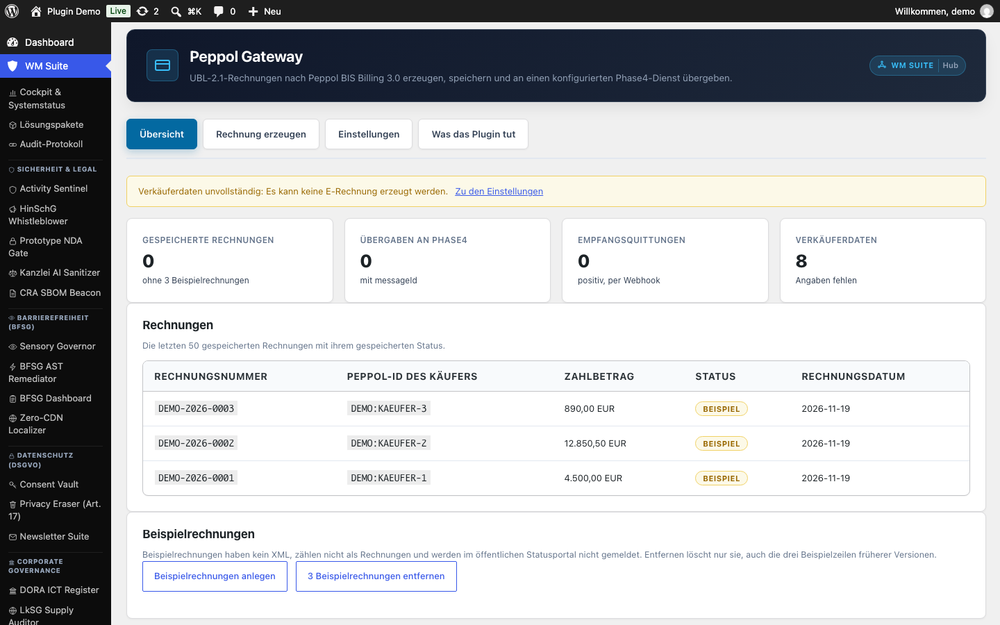
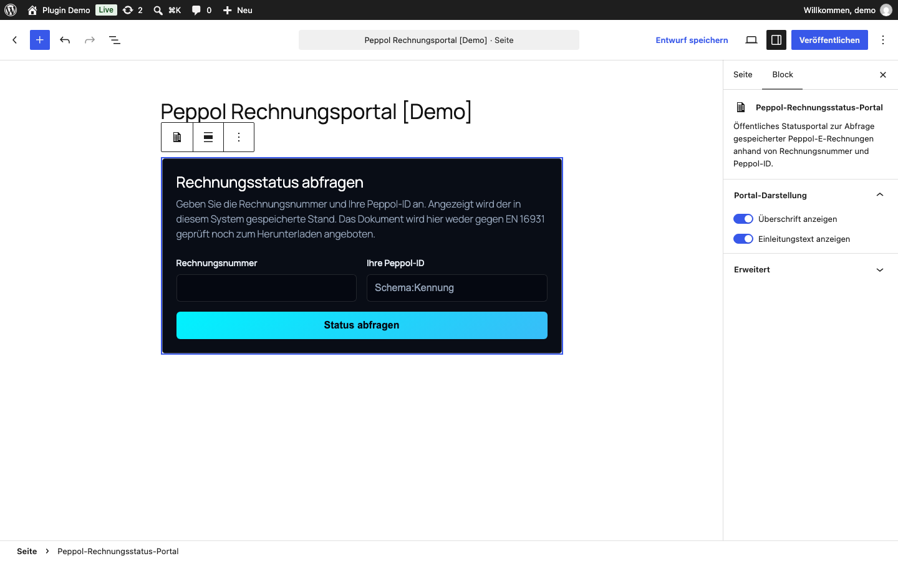
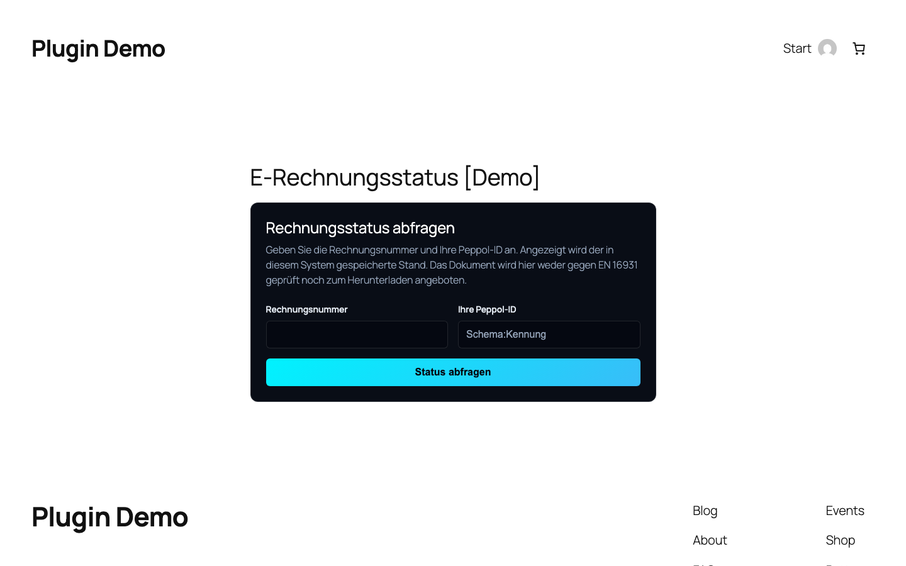

# WM Peppol AS4 Gateway (Deutsche Dokumentation)

<p align="center">
  <a href="README.md"></a>
  <a href="README.de.md"></a>
  <a href="README.es.md"></a>
</p>

[](https://wordpress.org)
[](https://php.net)
[](LICENSE)

> **Plugin-Seite:** [https://arnoldwender.com/wordpress-plugins/wm-peppol-as4-gateway/](https://arnoldwender.com/wordpress-plugins/wm-peppol-as4-gateway/)  
> **Mit einem agentischen Workflow entwickelt:** entstanden mit KI-Coding-Agenten. Prüfen und testen Sie es wie jeden fremden Code, bevor Sie es produktiv einsetzen.  
> **Support & Haftung:** Kein Support (Zero Support) — reproduzierbare Bugs ausschließlich über [GitHub Issues](https://github.com/arnoldwender/wm-wp-peppol-as4-gateway/issues) · kein privater Support · OHNE GEWÄHR („AS IS“) / keine Haftung ([SUPPORT.md](SUPPORT.md))

Ein WordPress-Plugin, das UBL-2.1-Rechnungen mit der Spezifikationskennung Peppol BIS Billing 3.0 erzeugt, sie strukturell sowie gegen das amtliche EN-16931-Regelwerk prüft, speichert, Rechnungen abgeschlossener WooCommerce-Bestellungen an einen separat betriebenen KoSIT-Validator und Phase4-Sender übergibt und Käufern den gespeicherten Status einer Rechnung anzeigt.

Das Plugin signiert, verschlüsselt oder überträgt AS4-Nachrichten nicht selbst; seit dem 16.09.2026 fragt es jedoch einen Peppol-Empfänger über SML und SMP ab. Frühere Marketing-Banner und frühe UI-Mockups wurden am 20.11.2026 außerhalb des Repositorys archiviert (Release 1.2.0).

---

## Live-Vorschau

!WM Peppol AS4 Gateway Banner

| Übersicht | Block-Editor | Öffentliches Statusportal |
|---|---|---|
|  |  |  |

---

## Was das Plugin leistet

**Rechnungsgenerator** (`WMCyber\Peppol\UBL\UblInvoiceGenerator::build()`)

* Erstellt eine UBL-2.1-`Invoice` in Schema-Reihenfolge mit Peppol-BIS-Billing-3.0-`CustomizationID` und -`ProfileID`.
* Verweigert die Rechnungserstellung bei fehlenden Pflichtdaten statt Platzhalter zu erfinden (`InvoiceDataException` mit Problemcodes und deutschen Meldungen). Erforderlich: Rechnungsnummer, Käuferreferenz (BT-10, PEPPOL-EN16931-R003), Käufer-Endpoint, Name und Land, Verkäufer-Endpoint, Name, Straße, Ort, PLZ, Land und USt-IdNr. sowie Verkäufer-IBAN bei Überweisung (BR-61).
* `EndpointID` trägt den Bezeichner mit Schema in `@schemeID`; `381` (Gutschrift) wird abgelehnt, da der Generator keine `CreditNote`-Syntax erzeugt.
* Unterstützt Beträge aus `lines`, `net_amount` oder Brutto-`payable_amount` (inkl. `PayableRoundingAmount` BT-114), Zu-/Abschläge (BG-20/21), Abrechnungszeitraum (BG-14) und vorausgehende Rechnungsreferenzen (BG-3).

**Strukturprüfungen** (`WM_Peppol_Validator`, `wp peppol validate`)

* UBL Invoice und CreditNote: BR-01 bis BR-16, BR-CO-10, -13, -15, -16, -18, Peppol-Typcodelisten (P0100, P0101), PEPPOL-EN16931-R003, Syntax von BR-CL-01 und BR-CL-04, BR-DE-15 für XRechnung-Profile.
* CII: Kopfdaten, Namen und die drei Gesamtsummen. Eigene Strukturprüfungen des Plugins, keine XSD-Schema-Validierung.

**WooCommerce-Bestellablauf** (`WMCyber\Peppol\WooCommerce\WooCommerceInvoiceHook`)

* Bei `woocommerce_order_status_completed` erhält eine Bestellung mit Empfänger-ID (`_peppol_endpoint_id`) eine Rechnung `INV-WC-<order id>` (Käuferreferenz aus Leitweg-ID oder Bestellreferenz).
* Fehlende Verkäuferdaten oder uneinheitliche Steuersätze schreiben eine Bestellnotiz und erzeugen keine Rechnung.
* Sind beide Dienst-URLs konfiguriert, läuft der Versand geplant: Strukturprüfung, KoSIT-Validator, Phase4-Sender; die gespeicherte `messageId` wird in `wm_peppol_transmissions` abgelegt.

**Zustellnachweis** (`WMCyber\Peppol\AS4\ReceiptEvidence`, `WMCyber\Peppol\AS4\DeliveryRegister`, `wp peppol receipts`)

* Der Quittungs-Webhook prüft eine mitgesandte signierte AS4-Quittung (`as4Receipt`): XMLDSig-Signatur und kanonisierte `ds:Reference`-Digests gegen das im X.509-Zertifikat enthaltene Zertifikat (inkl. `notBefore`/`notAfter` sowie optionalem SHA-256-Pin `wm_peppol_trusted_signer_sha256` / lokalem CA-Bundle `wm_peppol_trust_bundle_pem` ohne Online-CRL/OCSP-Abfrage) und vergleicht die `ebbpsig:NonRepudiationInformation`-Digests mit der gespeicherten XML (`yes`, `no`, `unknown`).
* Ungültige Quittungen werden mit HTTP 422 abgelehnt und in der HMAC-verketteten Tabelle `wm_peppol_audit_log` protokolliert (`wp peppol receipts --verify`). Kein Zeitstempel eines Vertrauensdiensteanbieters und kein qualifiziertes Siegel.

**EN-16931-Regelwerk** (`WMCyber\Peppol\Validation\SchematronValidator`, `wp peppol schematron`, `POST /wm-peppol/v1/schematron`)

* Bewertet das offizielle Validierungsartefakt der Europäischen Kommission, Release **1.3.16 vom 13.04.2026** (**979 Assertions**; `includes/Validation/En16931RuleSet.php` generiert durch `tools/en16931-compile-schematron.php`, gemessen gegen **1129 offizielle Korpusfälle**). Dies ist keine Konformitätsaussage und keine XSD-Validierung; WooCommerce stoppt den Versand nur bei gesetztem `wm_peppol_schematron_gate = 1`.

**Empfängerermittlung (SML/SMP)** (`WMCyber\Peppol\Discovery\SmpClient`, `wp peppol lookup`, `POST /wm-peppol/v1/lookup`)

* Löst per DNS-NAPTR über die Peppol SML den zuständigen SMP auf und liest den Endpunkt für `peppol-transport-as4-v2_0` samt Zertifikatsdaten (`certificate_expired`-Prüfung ohne PKI-Kettenprüfung). Testzone über `wp option update wm_peppol_sml_zone test`.

**Quittungs-Webhook, Statusportal, Hooks & Hub**

* Webhook `POST /wp-json/peppol/v1/receipt`, Statusportal (Shortcodes `[wm_peppol_invoice_portal]` und `[wm_e_invoice_lookup]`, Block `wm/peppol-invoice-portal`, WP-6.5+-Block-Bindings `wm-peppol/status`, GenerateBlocks-2.x-Tag `{{wm_peppol_status}}`), Hooks (`wm_peppol_ready`, `wm_peppol_invoice_recorded`, `wm_peppol_ubl_document`, `wm_peppol_rest_rate_limit`), Admin-Bereich *Peppol Gateway*, Dashboard-Widget und WM-Suite-Hub-Adapter.

## Was nicht enthalten ist

* AS4-Signatur, -Verschlüsselung und -Transport im Plugin selbst (übernimmt der externe Phase4-Dienst).
* CreditNote-Syntax und Steuerbefreiungsgründe.
* XSD-Schema-Validierung.
* Archivierung: Standardmäßig (`wm_peppol_delete_data_on_uninstall = 0`) bleiben Optionen und die drei Tabellen (`wm_peppol_invoices`, `wm_peppol_transmissions`, `wm_peppol_audit_log`) bei Deinstallation erhalten; nur bei aktivierter Opt-in-Option werden sie gelöscht.

## Voraussetzungen & Konfiguration

* WordPress 6.4+, PHP 8.1+, optional WooCommerce, KoSIT-Validator und Phase4-Sender.
* Konfiguration unter *Peppol Gateway › Einstellungen* (`wm_peppol_endpoint_id`, `wm_peppol_seller_*`, `wm_peppol_kosit_url`, `wm_peppol_phase4_url`, `WM_PEPPOL_RECEIPT_SECRET` / `wm_peppol_receipt_secret`, `wm_peppol_delete_data_on_uninstall`).

## WP-CLI (`wp peppol`) & REST-API

* Befehle: `wp peppol status`, `wp peppol validate <datei>`, `wp peppol receipts [--verify]`, `wp peppol schematron <datei> [--coverage]`, `wp peppol list-invoices`, `wp peppol generate-ubl <nummer> --data=invoice.json`, `wp peppol lookup <participant-id>`.
* REST-Routen: `GET /wp-json/wm-peppol/v1/invoices`, `POST /wp-json/wm-peppol/v1/invoices/generate`, `POST /wp-json/wm-peppol/v1/lookup`, `POST /wp-json/wm-peppol/v1/schematron` (`manage_options`), `POST /wp-json/wm-peppol/v1/invoice-status` (öffentlich, Ratenlimit via `wm_peppol_rest_rate_limit`), `POST /wp-json/peppol/v1/receipt` (`X-WM-Peppol-Signature`).

## Tests & Dokumentation

```bash
php tests/test-suite.php
php tools/en16931-schematron-conformance.php --corpus=tests/fixtures/en16931-1.3.16 --min=100
php tools/en16931-compile-schematron.php --download --check
bash tests/run-mutations.sh
vendor/bin/phpunit -c phpunit.xml
python3 .github/scripts/security-audit.py
```

Siehe [README.md](README.md) (englische Referenz), [docs/ARCHITECTURE.md](docs/ARCHITECTURE.md), [docs/DEVELOPER-GUIDE.md](docs/DEVELOPER-GUIDE.md), [docs/LEGAL-COMPLIANCE.md](docs/LEGAL-COMPLIANCE.md) und [CHANGELOG.md](CHANGELOG.md).

## Lizenz

Veröffentlicht unter **GNU General Public License v2 or later** (`LICENSE`). Copyright (C) 2026 Arnold Wender.
