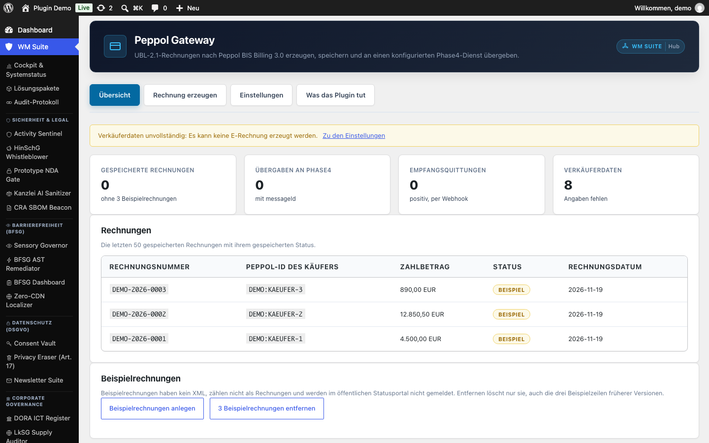
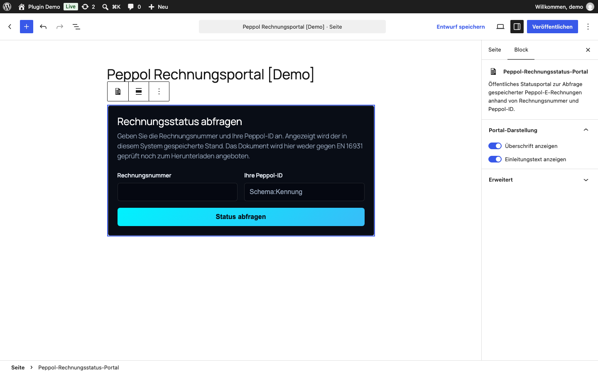
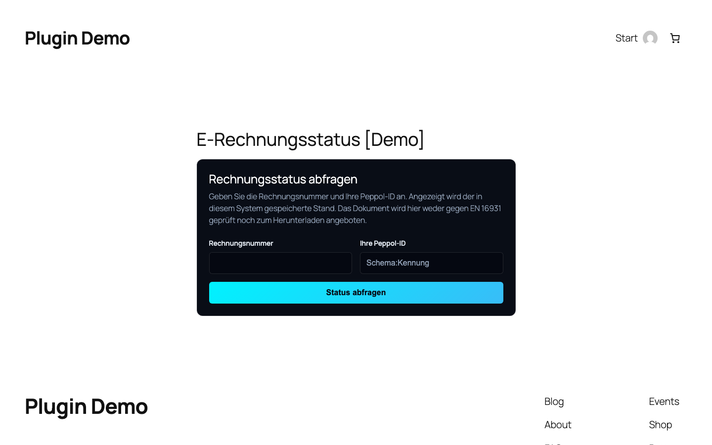

# WM Peppol AS4 Gateway (Documentación en Español)

<p align="center">
  <a href="README.md"></a>
  <a href="README.de.md"></a>
  <a href="README.es.md"></a>
</p>

[](https://wordpress.org)
[](https://php.net)
[](LICENSE)

> **Página del Plugin:** [https://arnoldwender.com/es/plugins-wordpress/wm-peppol-as4-gateway/](https://arnoldwender.com/es/plugins-wordpress/wm-peppol-as4-gateway/)  
> **Desarrollado con un agentic workflow:** creado con agentes de programación de IA. Revísalo y pruébalo como cualquier código de terceros antes de usarlo en producción.  
> **Soporte y responsabilidad:** Cero soporte (Zero Support) — errores reproducibles únicamente en [GitHub Issues](https://github.com/arnoldwender/wm-wp-peppol-as4-gateway/issues) · sin soporte privado · TAL CUAL («AS IS») / sin responsabilidad ([SUPPORT.md](SUPPORT.md))

Plugin para WordPress que genera facturas UBL 2.1 con el identificador de especificación Peppol BIS Billing 3.0, las valida estructuralmente y contra el conjunto oficial de reglas EN 16931, las almacena, entrega facturas de pedidos completados de WooCommerce a un validador KoSIT y un emisor Phase4 ejecutados por separado, y muestra a los compradores el estado guardado de cada factura.

El plugin no firma, cifra ni transmite mensajes AS4 por sí mismo; desde el 16/09/2026 sí resuelve el punto de acceso receptor en Peppol mediante SML y SMP. Los banners promocionales y maquetas anteriores se archivaron fuera del repositorio el 20/11/2026 (versión 1.2.0).

---

## Capturas en vivo

!Banner de WM Peppol AS4 Gateway

| Resumen | Editor de Bloques | Portal Público de Estado |
|---|---|---|
|  |  |  |

---

## Qué hace el plugin

**Generador de facturas** (`WMCyber\Peppol\UBL\UblInvoiceGenerator::build()`)

* Construye una factura UBL 2.1 `Invoice` en orden de esquema con `CustomizationID` y `ProfileID` de Peppol BIS Billing 3.0.
* Rechaza generar la factura si faltan datos obligatorios en lugar de rellenar valores inventados (`InvoiceDataException`). Requiere número de factura, referencia de comprador (BT-10, PEPPOL-EN16931-R003), endpoint, nombre y país del comprador, datos fiscales y endpoint del vendedor e IBAN del vendedor en transferencias (BR-61). El código `381` se rechaza al no emitir sintaxis `CreditNote`.
* Soporta cálculo desde líneas, importe neto o `payable_amount` bruto con `PayableRoundingAmount` (BT-114), cargos/descuentos (BG-20/21), periodo (BG-14) y referencias previas (BG-3).

**Comprobaciones estructurales** (`WM_Peppol_Validator`, `wp peppol validate`)

* UBL Invoice y CreditNote (BR-01 a BR-16, BR-CO-10, -13, -15, -16, -18, listas P0100/P0101, PEPPOL-EN16931-R003, BR-CL-01/04, BR-DE-15) y cabecera/totales CII. Son comprobaciones propias del plugin, no validación XSD.

**Flujo de pedidos WooCommerce** (`WMCyber\Peppol\WooCommerce\WooCommerceInvoiceHook`)

* En `woocommerce_order_status_completed`, si el pedido incluye `_peppol_endpoint_id`, genera la factura `INV-WC-<order id>` con la Leitweg-ID o referencia de comprador. Si faltan datos o hay tasas incompatibles deja una nota en el pedido sin emitir factura. Con ambas URLs configuradas ejecuta un evento programado que pasa por el validador KoSIT y el emisor Phase4, guardando el `messageId` en `wm_peppol_transmissions`.

**Evidencia de entrega** (`WMCyber\Peppol\AS4\ReceiptEvidence`, `WMCyber\Peppol\AS4\DeliveryRegister`, `wp peppol receipts`)

* El webhook verifica la firma XMLDSig del `as4Receipt` frente al certificado X.509 incluido (incluyendo validez temporal `notBefore`/`notAfter` y comprobación local opcional mediante huella SHA-256 `wm_peppol_trusted_signer_sha256` o bundle CA local `wm_peppol_trust_bundle_pem` sin llamadas CRL/OCSP en red) y contrasta los resúmenes de `ebbpsig:NonRepudiationInformation` con el XML almacenado (`yes`, `no`, `unknown`).
* Las recepciones no válidas se rechazan con HTTP 422 y quedan registradas en `wm_peppol_audit_log` con cadena HMAC (`wp peppol receipts --verify`). No sustituye un sello cualificado ni un sellado temporal de terceros.

**Conjunto de reglas EN 16931** (`WMCyber\Peppol\Validation\SchematronValidator`, `wp peppol schematron`, `POST /wm-peppol/v1/schematron`)

* Evalúa el artefacto oficial de validación de la Comisión Europea **1.3.16 del 13/04/2026** (**979 aserciones** compiladas en `includes/Validation/En16931RuleSet.php`, verificado frente a **1129 casos oficiales**). No constituye una declaración de conformidad ni validación XSD; bloquea envíos WooCommerce solo si `wm_peppol_schematron_gate = 1`.

**Descubrimiento de receptor (SML/SMP)** (`WMCyber\Peppol\Discovery\SmpClient`, `wp peppol lookup`, `POST /wm-peppol/v1/lookup`)

* Consulta SML por DNS NAPTR y luego SMP para obtener el punto de acceso `peppol-transport-as4-v2_0`, identificadores de proceso y fechas del certificado. Permite zona de pruebas mediante `wp option update wm_peppol_sml_zone test`.

**Webhook, portal de estado, hooks y Hub**

* Webhook `POST /wp-json/peppol/v1/receipt`, portal público (`[wm_peppol_invoice_portal]`, `[wm_e_invoice_lookup]`, bloque `wm/peppol-invoice-portal`, Block Bindings `wm-peppol/status`, etiqueta GenerateBlocks `{{wm_peppol_status}}`), hooks (`wm_peppol_ready`, `wm_peppol_invoice_recorded`, `wm_peppol_ubl_document`, `wm_peppol_rest_rate_limit`), pantalla de administración, widget del escritorio y adaptador para WM Suite Hub.

## Qué no está implementado

* Firma, cifrado y transporte AS4 dentro del plugin (lo realiza el servicio Phase4 externo).
* Sintaxis CreditNote y exenciones fiscales.
* Validación contra esquema XSD.
* Archivo histórico: por defecto (`wm_peppol_delete_data_on_uninstall = 0`), la desinstalación conserva opciones y las tres tablas (`wm_peppol_invoices`, `wm_peppol_transmissions`, `wm_peppol_audit_log`); solo se eliminan si se habilita explícitamente la opción de borrado.

## Requisitos y configuración

* WordPress 6.4+, PHP 8.1+, opcionalmente WooCommerce, validador KoSIT y emisor Phase4.
* Ajustes en *Peppol Gateway › Einstellungen* (`wm_peppol_endpoint_id`, `wm_peppol_seller_*`, `wm_peppol_kosit_url`, `wm_peppol_phase4_url`, `WM_PEPPOL_RECEIPT_SECRET` / `wm_peppol_receipt_secret`, `wm_peppol_delete_data_on_uninstall`).

## WP-CLI (`wp peppol`) y API REST

* Comandos: `wp peppol status`, `wp peppol validate <archivo>`, `wp peppol receipts [--verify]`, `wp peppol schematron <archivo> [--coverage]`, `wp peppol list-invoices`, `wp peppol generate-ubl <numero> --data=invoice.json`, `wp peppol lookup <participant-id>`.
* Rutas REST: `GET /wp-json/wm-peppol/v1/invoices`, `POST /wp-json/wm-peppol/v1/invoices/generate`, `POST /wp-json/wm-peppol/v1/lookup`, `POST /wp-json/wm-peppol/v1/schematron` (`manage_options`), `POST /wp-json/wm-peppol/v1/invoice-status` (pública con límite de tasa vía `wm_peppol_rest_rate_limit`), `POST /wp-json/peppol/v1/receipt` (`X-WM-Peppol-Signature`).

## Pruebas y documentación

```bash
php tests/test-suite.php
php tools/en16931-schematron-conformance.php --corpus=tests/fixtures/en16931-1.3.16 --min=100
php tools/en16931-compile-schematron.php --download --check
bash tests/run-mutations.sh
vendor/bin/phpunit -c phpunit.xml
python3 .github/scripts/security-audit.py
```

Véase [README.md](README.md) (referencia en inglés), [docs/ARCHITECTURE.md](docs/ARCHITECTURE.md), [docs/DEVELOPER-GUIDE.md](docs/DEVELOPER-GUIDE.md), [docs/LEGAL-COMPLIANCE.md](docs/LEGAL-COMPLIANCE.md) y [CHANGELOG.md](CHANGELOG.md).

## Licencia

Distribuido bajo licencia **GNU General Public License v2 or later** (`LICENSE`). Copyright (C) 2026 Arnold Wender.
