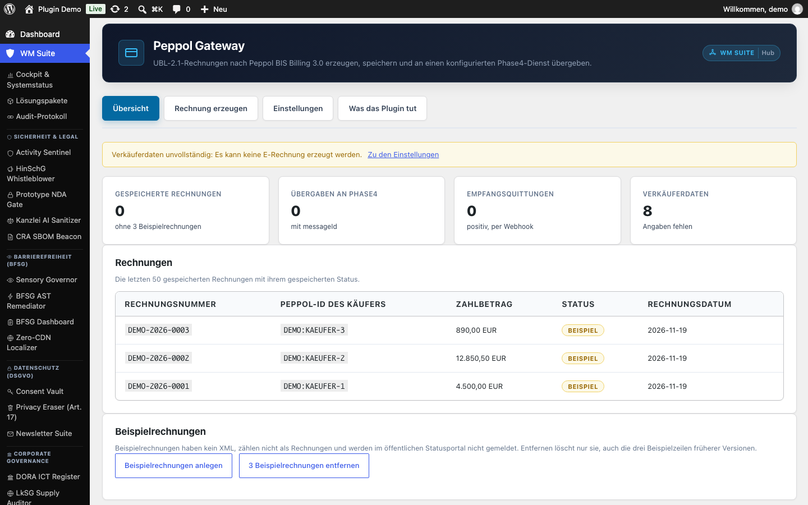
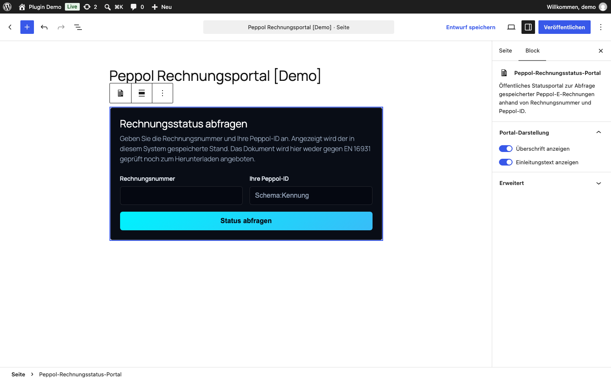
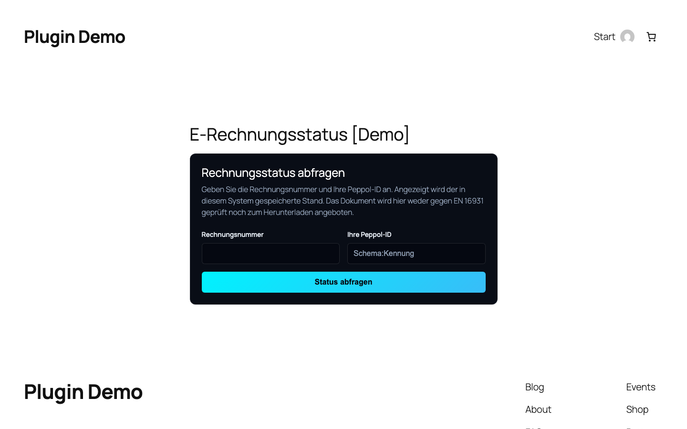

# WM Peppol AS4 Gateway

<p align="center">
  <a href="README.md"></a>
  <a href="README.de.md"></a>
  <a href="README.es.md"></a>
</p>

[](https://wordpress.org)
[](https://php.net)
[](LICENSE)

> **Plugin Page:** [https://arnoldwender.com/wordpress-plugins/wm-peppol-as4-gateway/](https://arnoldwender.com/wordpress-plugins/wm-peppol-as4-gateway/)  
> **Built with an agentic workflow:** developed with AI coding agents. Review and test it like any third-party code before you use it in production.  
> **Support & Liability:** Zero support — reproducible bugs on [GitHub Issues](https://github.com/arnoldwender/wm-wp-peppol-as4-gateway/issues) only · no private support · AS IS / no liability ([SUPPORT.md](SUPPORT.md))

A WordPress plugin that builds UBL 2.1 invoices carrying the Peppol BIS Billing 3.0 specification identifier, checks them structurally, stores them, hands the invoices of completed WooCommerce orders to a KoSIT validator and a Phase4 sender that you run separately, and shows buyers the stored status of an invoice.

The plugin does not sign, encrypt or transmit AS4 messages itself. Since 2026-09-16 it does look a Peppol receiver up in the SML and its SMP. The README was rewritten against the code on 2026-09-15 after a reader audit; `tests/test-suite.php` checks that it does not repeat the claims of the earlier version. Superseded promotional banners and early UI mockups were archived outside the repository on 2026-11-20 (release 1.2.0).

---

## Showcase

!WM Peppol AS4 Gateway banner

| Overview | Block Editor | Public Status Portal |
|---|---|---|
|  |  |  |

---

## What it does

**Invoice generator** (`WMCyber\Peppol\UBL\UblInvoiceGenerator::build()`)

* Builds a UBL 2.1 `Invoice` in schema sequence order with the Peppol BIS Billing 3.0 CustomizationID and ProfileID.
* Refuses an invoice instead of filling gaps. Required: invoice number, buyer reference (BT-10, PEPPOL-EN16931-R003), buyer endpoint, name and country, seller endpoint, name, street, city, postal code, country and VAT id, and the seller IBAN when payment is by credit transfer (BR-61). Missing data raises `InvoiceDataException` with problem codes and German sentences.
* `EndpointID` holds the identifier with the scheme in `@schemeID`; a participant id is written `<four-digit EAS scheme>:<identifier>`, for example `9930:DE123456789`.
* One VAT breakdown per category and rate (BR-S-08, BR-S-09); a standard-rated line needs a rate above zero (BR-S-05).
* Amounts from `lines`, from `net_amount`, or from a gross `payable_amount`. With a gross amount, what the per-rate tax calculation leaves over is emitted as `PayableRoundingAmount` (BT-114), so the amount due stays the amount given (BR-CO-16).
* Invoice type codes of the Peppol list for invoices. `381` is refused: Peppol BIS lists it only for the CreditNote syntax, which the generator does not produce.
* Optional: allowances and charges (BG-20/21), invoice period (BG-14), preceding invoice references (BG-3), prepaid amount, payment terms, note, delivery date (defaults to the issue date), due date (defaults to 14 days).

**Structural checks** (`WM_Peppol_Validator`, `wp peppol validate`)

* UBL Invoice and CreditNote: BR-01 to BR-16, BR-CO-10, -13, -15, -16, -18, the Peppol type code lists (P0100, P0101), PEPPOL-EN16931-R003, the syntax of BR-CL-01 and BR-CL-04, BR-DE-15 for XRechnung profiles.
* CII: header, names and the three header totals.
* These are the plugin's own structural checks, not an XSD schema validation and not the rule set below. `wp peppol validate` keeps doing exactly what it did; the EN 16931 rules are a separate, wider run.

**WooCommerce order flow** (`WMCyber\Peppol\WooCommerce\WooCommerceInvoiceHook`)

* On `woocommerce_order_status_completed`, an order with a Peppol receiver id (order field `_peppol_endpoint_id`) gets one invoice, `INV-WC-<order id>`, built from the order lines, their tax rates, shipping and fee lines and the billing address. The buyer reference is the Leitweg-ID or the buyer reference entered on the order.
* An order the plugin cannot describe without invented data gets an order note that says why, and no invoice: missing seller data, an item without tax or with several rates, a total that differs from the document by more than a cent per position.
* When both service URLs are configured, sending runs as a scheduled event: the plugin's structural checks, the KoSIT validator, then the Phase4 sender. The XML sent is the XML stored. The `messageId` the sender returns is stored in `wm_peppol_transmissions`; an answer without one is a failed dispatch.
* The order documents the order total as the amount due with the seller's IBAN, also for orders paid online.

**Delivery evidence** (`WMCyber\Peppol\AS4\ReceiptEvidence`, `WMCyber\Peppol\AS4\DeliveryRegister`, `wp peppol receipts`)

The receipt webhook accepts the signed AS4 receipt itself in `as4Receipt`, and measures two things separately instead of reporting one verdict:

* **Is the receipt authentic?** Its XMLDSig signature is verified against the X.509 certificate it carries: the `ds:SignedInfo` is canonicalised by the method it names (exclusive or inclusive, with the `InclusiveNamespaces` prefix list when present), the signature is checked with OpenSSL, and every `ds:Reference` is re-digested against the content it points at — including the `enveloped-signature` transform. A receipt edited after signing fails here.
* **Is it about this invoice?** The `ds:Reference` digests inside `ebbpsig:NonRepudiationInformation` are compared with the XML this site stored and handed over. The answer is `yes`, `no` or `unknown`; `unknown` means there was nothing to compare, and is never reported as a match.

A receipt whose signature does not verify, or whose digests are of another document, is **refused with 422 and does not mark the invoice delivered** — and the refusal is recorded, because a rejected receipt is evidence of what arrived. A call without `as4Receipt` behaves exactly as before.

Accepted and refused receipts are appended to `wm_peppol_audit_log`, one row per receipt, each carrying the fingerprint of the row before it (HMAC-SHA256 keyed with the site's `AUTH_KEY`). Editing or removing a row breaks every fingerprint after it. `wp peppol receipts --verify` recomputes the chain and names the first row that does not hold. The rows keep the measurements and the receipt's SHA-256, never the receipt body and never an address.

**What is not claimed:** certificate validity dates (`notBefore` / `notAfter`) are enforced, and when a SHA-256 pin (`wm_peppol_trusted_signer_sha256` / `WM_PEPPOL_TRUSTED_SIGNER_SHA256`) or a local CA PEM bundle (`wm_peppol_trust_bundle_pem` / `WM_PEPPOL_TRUST_BUNDLE_PEM` / `WM_PEPPOL_TRUST_BUNDLE_FILE`) is configured, the signing certificate is verified against it locally with zero network calls; online CRL/OCSP revocation is not checked and not claimed. When neither pin nor CA bundle nor `wm_peppol_require_trust_anchor` is set, `trust_status` reports `unconfigured`. The register is not a timestamp from a trusted third party and not a qualified seal: it shows the rows have not changed since this site wrote them. Restoring the database onto a site with different salts makes the chain unverifiable, which the verifier says rather than hides.

**EN 16931 rule set** (`WMCyber\Peppol\Validation\SchematronValidator`, `wp peppol schematron`, `POST /wm-peppol/v1/schematron`)

* Evaluates the official validation artefact of the European Commission, release **1.3.16 of 2026-04-13**: **979 assertions**, of which 223 are EN 16931 business rules (BR, BR-CO, BR-CL, BR-DEC and the VAT category families) and 756 are UBL syntax rules. 281 are fatal.
* `includes/Validation/En16931RuleSet.php` is generated, never hand-edited: `tools/en16931-compile-schematron.php` reads the artefact and translates its XPath 2.0 into the XPath 1.0 that libxml evaluates. A rule it cannot translate stays in the table marked unsupported and is named by `wp peppol schematron --coverage`, because a rule that disappears reads as a rule that passed. Today: none.
* Measured against the artefact's own corpus: **1129 cases over 201 rules, every one matching the expectation the standard declares for it**, and the 18 shipped example invoices produce no fatal finding. CI re-runs both, and re-downloads the artefact to confirm the committed table still matches it.
* An expression the engine cannot evaluate is reported in `unevaluated`. It is neither a finding nor a pass.
* **This is not a conformance statement.** It is not the reference implementation, it does not run the official XSLT, and it is not an XSD schema validation. A document with no finding can still be refused by an access point.
* On a WooCommerce dispatch the rule set runs and a fatal finding is written to the order. It stops the dispatch only when `wm_peppol_schematron_gate` is `1`, so a site that dispatches today does not start failing on a rule its access point tolerates.

**Receiver discovery** (`WMCyber\Peppol\Discovery\SmpClient`, `wp peppol lookup`, `POST /wm-peppol/v1/lookup`)

* Asks the Peppol SML over DNS which SMP serves a participant, then asks that SMP which access point receives a document type, and reports what the SMP answered.
* The SML name is Base32 (RFC 4648, no padding) of the SHA-256 of the lower-cased identifier value, then the identifier scheme, then the zone: `<hash>.iso6523-actorid-upis.participant.sml.prod.tech.peppol.org`. No prefix, no md5. Measured against the production SML on 2026-09-16.
* Of the NAPTR records of that name, the lowest order then the lowest preference wins (RFC 3403), among those whose service is `Meta:SMP` and whose replacement is an http(s) URL.
* From the SMP's service metadata the plugin reads the endpoint whose `transportProfile` is `peppol-transport-as4-v2_0`: address, process identifiers, certificate subject and validity dates, service activation and expiration dates.
* `certificate_expired` compares the dates in the certificate with now. Whether the certificate chains to the Peppol PKI is not checked and not claimed.
* `wp option update wm_peppol_sml_zone test` asks the test SML (SMK) instead of production. A successful lookup is cached for six hours; a failure is not cached.
* Each step fails with its own error code, so a participant that is not registered (404 `wm_peppol_smp_dns_failed`) is a different answer from a receiver that does not accept this document type (404 `wm_peppol_smp_document_not_offered`), from an SMP that did not answer (502 `wm_peppol_smp_http_failed`) and from an identifier of the wrong shape (400 `wm_peppol_smp_bad_identifier`).

**Receipt webhook** (`POST /wp-json/peppol/v1/receipt`), **status portal** (shortcode `[wm_peppol_invoice_portal]`, alias `[wm_e_invoice_lookup]`, Gutenberg block `wm/peppol-invoice-portal` with Block Inserter preview, WP 6.5+ Block Bindings source `wm-peppol/status` and GenerateBlocks 2.x dynamic tag `{{wm_peppol_status}}`), **extensibility hooks** (`wm_peppol_ready`, `wm_peppol_invoice_recorded`, `wm_peppol_ubl_document`, `wm_peppol_rest_rate_limit`), **admin page** "Peppol Gateway" (overview, invoice generator, settings, what the plugin does), **dashboard widget** and **hub adapter**: see below.

## What is not implemented

* AS4 signing, encryption and transport. The Phase4 service does that with its own certificates. The classes that build an SBDH envelope and an ebMS3 UserMessage are kept, but no runtime path sends their output.
* CreditNote syntax and tax exemptions (categories other than standard rate need exemption data the plugin does not collect).
* XSD schema validation. The EN 16931 Schematron rule set is implemented (see above); validation against the UBL 2.1 XSD is not.
* An archive. By default (`wm_peppol_delete_data_on_uninstall = 0`), uninstall preserves options and the three tables; when that opt-in setting is enabled before uninstall, stored invoices and the delivery register are deleted without export.
* The older HMAC ledger class (`WM_Peppol_Database`) is still loaded and still writes to a table layout the plugin does not create; nothing calls it. The delivery register is a separate class against the table the plugin does create.

## Requirements

* WordPress 6.4 or later, PHP 8.1 or later.
* WooCommerce for the order flow (optional).
* A KoSIT validator and a Phase4 sender reachable from the site for sending (optional). `docker-compose.yml` starts both locally; it is not part of the plugin ZIP.

## Configuration

Peppol Gateway > Einstellungen:

* Seller: Peppol id, name, legal name, street, postal code, city, country, VAT id, register number, IBAN. Options `wm_peppol_endpoint_id` and `wm_peppol_seller_*`.
* Dispatch: KoSIT validator URL and Phase4 URL (options `wm_peppol_kosit_url`, `wm_peppol_phase4_url`; the constants `WM_PEPPOL_KOSIT_URL` and `WM_PEPPOL_PHASE4_URL` win). Nothing is sent while either is empty.
* Receipt secret: constant `WM_PEPPOL_RECEIPT_SECRET` or `wp option update wm_peppol_receipt_secret <secret>`. The screen shows whether it is set, never the value.
* Uninstall: option `wm_peppol_delete_data_on_uninstall` (default `0`). Options and the three Peppol tables stay in the database unless this setting is enabled before deleting the plugin.

## WP-CLI (`wp peppol`)

```bash
# Version, tables and row counts, seller data, dispatch, receipt secret, SML zone
wp peppol status

# Structural checks of an invoice file (UBL Invoice/CreditNote or CII); exits 1 when a check fails
wp peppol validate /path/to/invoice.xml

# The delivery register: one chained row per verified AS4 receipt
wp peppol receipts [--limit=20] [--format=table|json|yaml]
wp peppol receipts --verify      # recompute the chain; exits 1 when a row was changed or removed

# The official EN 16931 rule set over a UBL file; exits 1 on a fatal finding
wp peppol schematron /path/to/invoice.xml [--warnings] [--format=table|json]
wp peppol schematron --coverage          # which rules the shipped table holds and which are evaluated

# Recent stored invoices; in csv a cell starting with = + - @ or a tab gets an apostrophe
wp peppol list-invoices [--limit=20] [--format=table|json|csv|yaml]

# Build a document without storing or sending it; parties and positions come from a JSON file
wp peppol generate-ubl INV-2026-001 --data=invoice.json [--amount=119.00] [--output=/tmp/invoice.xml]

# SML then SMP: the receiving access point of a participant, its certificate and its dates
wp peppol lookup 0007:5567321707 [--document-type=<id>] [--format=table|json|yaml]
```

## REST API

| Route | Method | Access | Answer |
| --- | --- | --- | --- |
| `/wp-json/wm-peppol/v1/invoices` | GET | `manage_options` | Most recent invoices, `limit` 1-500, default 50 |
| `/wp-json/wm-peppol/v1/invoices/generate` | POST | `manage_options` | JSON object with the generator input. 201 with invoice id, payable amount and SHA-256; 400 for a body that is not a JSON object or for missing data (with `problems`); 409 for a known invoice number; 500 when the row was not stored |
| `/wp-json/wm-peppol/v1/lookup` | POST | `manage_options` | `participant_id` (required) and `document_type`. 200 with the access point, its transport profile, process ids and certificate dates; 400, 404 or 502 with the error code of the step that failed |
| `/wp-json/wm-peppol/v1/schematron` | POST | `manage_options` | `xml` (required). 200 with the findings, the artefact version and the number of rules evaluated, whether or not anything fired; `fatal` is the number to act on. 400 when the body is not well-formed XML |
| `/wp-json/wm-peppol/v1/invoice-status` | POST | public, rate-limited (60 req/min via `wm_peppol_rest_rate_limit`, 20 lookups/hour per hashed address) | Stored status, transmission status and whether a receipt exists, for a caller who knows invoice number and buyer id. Unknown invoices and demo rows answer 200 with `found: false` |
| `/wp-json/peppol/v1/receipt` | POST | HMAC signature, see below | Applies a receipt |

## Receipt webhook

The Phase4 service posts receipts here. The route fails closed: until a shared secret is configured every request is refused (401 `wm_peppol_receipt_unconfigured`).

* Signature: header `X-WM-Peppol-Signature` = base64( HMAC-SHA256( raw request body, secret ) ). Missing: 401. Wrong: 403.
* Body: `messageId` (string, required), `status` (`SUCCESS` or `FAILURE`, required), `errorMessage`, `errorCode`.
* Optional `as4Receipt`: the signed AS4 receipt itself. It is verified and registered as described under **Delivery evidence**; without it the route behaves as it always did.
* Effect: the transmission row of that `messageId` becomes `delivered` or `failed` with the receipt body and error code, its invoice likewise; a WooCommerce order with that `messageId` gets a note and the status `completed` or `failed`. An unknown `messageId` answers 404.
* The signature scheme of the real access point is still to be decided; this is the fail-closed baseline.

## Data

Activation creates `wm_peppol_invoices`, `wm_peppol_transmissions` and `wm_peppol_audit_log`; the last one is the delivery register, written since 2026-09-16 by the receipt route. On multisite, network activation provisions those tables across existing blogs in the network, and `wp_initialize_site` creates them for newly added sites while the plugin is network-activated. The schema is also brought forward on `plugins_loaded` when the stored version differs, because a plugin updated in place is never re-activated.

Two options record a schema version, and only one of them is read:

* **`wm_peppol_schema_version`** (`Database\Schema::VERSION_OPTION`) is the live one. `Schema::maybe_upgrade()` compares it against `Schema::VERSION` on `plugins_loaded` and brings the tables forward when they differ. Lowering it by hand re-runs the upgrade on the next request.
* **`wm_peppol_db_version`** is written once by the legacy `WM_Peppol_Database::init()` and **never read by anything**. It belongs to the older layer that `wm-peppol-as4-gateway.php` still `require_once`s for its structural checks; the SBDH packaging and HMAC ledger in that file are loaded but unused at runtime. Changing or deleting it has no effect.

On uninstall, scheduled events (`wm_peppol_dispatch_invoice`) are cleared; options, transients, the empty `uploads/wm-peppol` directory of earlier versions and the three tables are preserved by default and deleted only when `wm_peppol_delete_data_on_uninstall` is set to `1` (both `wm_peppol_schema_version` and `wm_peppol_db_version` are removed in that opt-in cleanup, checked by `tests/groups/11-uninstall.php`). The Peppol fields entered on orders stay on the orders.

The demo button on the overview writes three rows with status `demo` and no XML; they count as no invoice and the portal does not report them. The removal button deletes them, and also the three stub rows the demo button of earlier versions wrote.

## Tests

```bash
php tests/test-suite.php          # standalone, SQLite; the last line is the results line
php tools/en16931-schematron-conformance.php --corpus=tests/fixtures/en16931-1.3.16 --min=100   # 1129 official cases
php tools/en16931-compile-schematron.php --download --check                                    # the rule table still matches the artefact
bash tests/run-mutations.sh       # every correction in tests/mutations.php must turn the suite red
vendor/bin/phpunit -c phpunit.xml # UBL document structure (composer install first)
python3 .github/scripts/security-audit.py
wp eval-file wp-content/plugins/wm-peppol-as4-gateway/tests/wp-runtime-peppol.php --user=1   # inside WordPress, writes nothing
```

## Sources

OASIS AS4 Profile of ebMS 3.0 v1.0 CS02, for the eb:Receipt and the ebbpsig:NonRepudiationInformation it must carry, and for the rule that a signed message is acknowledged with a signed receipt (checked 2026-09-16). EN 16931 validation artefacts for UBL, release 1.3.16 of 2026-04-13 (github.com/ConnectingEurope/eInvoicing-EN16931, EUPL 1.2), whose rules and test corpus the plugin evaluates and is measured against. Checked on 2026-09-15: Peppol BIS Billing 3.0, May 2026 release (docs.peppol.eu/poacc/billing/3.0/: UBL invoice syntax pages, code lists UNCL1001-inv, UNCL1001-cn, EAS and ICD, rules for EN 16931 bound to UBL and Peppol rules) and KoSIT "Leitweg-ID Format-Spezifikation" version 2.0.2 of 28.07.2021. No legal assessment of e-invoicing obligations is part of this documentation.

---

## License

Distributed under the **GNU General Public License v2 or later**.
Copyright (C) 2026 Arnold Wender.
